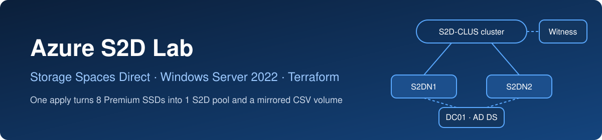
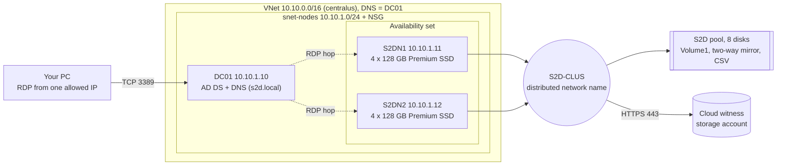
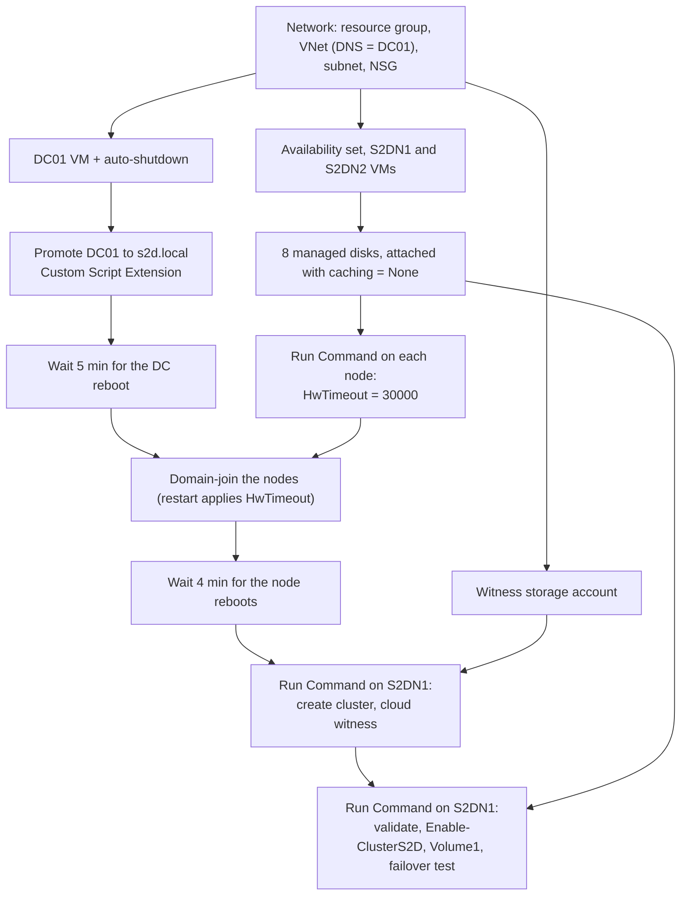

<div align="center">



[](https://github.com/andmurill/azure-s2d-lab/actions/workflows/terraform.yml)


**One `terraform apply` builds a domain, a two-node cluster, pools eight Premium SSDs with Storage Spaces Direct and serves a mirrored Cluster Shared Volume.**

[What it builds](#what-it-builds) · [Quick start](#quick-start) · [How it works](#how-it-works) · [Design decisions](#design-decisions-and-trade-offs) · [Verification](#verification-and-failover-test) · [Troubleshooting](#troubleshooting-log) · [Roadmap](#roadmap)

</div>

---

This is the storage-enabled sibling of my [azure-wsfc-lab](https://github.com/andmurill/azure-wsfc-lab). It reuses that lab's network, domain controller, domain join, cluster and cloud witness code, and adds what Storage Spaces Direct (S2D) needs inside Azure VMs: an availability set, Premium SSD data disks, a storage timeout setting, pool creation and a volume. It is the Azure version of a Hyper-V nested S2D lab, with the Hyper-V host replaced by Terraform.

## At a glance

| | |
|---|---|
| **Result** | AD DS forest `s2d.local`, a two-node cluster `S2D-CLUS` with a cloud witness, an S2D pool of 8 data disks and a 200 GB two-way mirror volume `Volume1` as a CSV |
| **Size** | 3 VMs (`Standard_B2ms`), 8 x 128 GB Premium SSD data disks, 1 availability set. `terraform plan` prints the exact resource count |
| **Tested with** | Terraform 1.17.0, azurerm 4.81.0, region `centralus`, tested 2026-11-08 |
| **Build time** | Not measured yet. The network, domain and cluster stages match the WSFC lab, which took about 24 minutes. The S2D stage is on the [roadmap](#roadmap) to time |
| **Skills shown** | Terraform (`for_each`, `setproduct`, `depends_on`), Azure compute and managed disks, S2D in guest VMs, unattended AD DS and clustering, troubleshooting |

## What it builds



- **DC01** is the only machine with a public IP, and the NSG allows RDP to it only from one address (`/32`) that you set. The nodes have no public IP, so you reach them by RDP from DC01.
- The VNet's DNS server is DC01, so the nodes can find the `s2d.local` domain.
- The two nodes sit in an **availability set**, which S2D in Azure VMs requires and which cannot be added to a VM after it is created.
- Every VM has a nightly auto-shutdown schedule.

## What this demonstrates

| Terraform | Windows Server and Azure |
|---|---|
| Remote state in Azure Storage, one state key per lab | S2D in guest VMs: availability set, Premium SSD, no host caching |
| `setproduct` and `for_each` to create nodes x disks | Unattended pool creation with `Enable-ClusterS2D` and a CSV volume |
| `depends_on` and `time_sleep` for ordering across reboots | Guest tuning (`HwTimeout`) before the domain-join restart |
| Run Command with protected parameters for guest configuration | Cloud witness for a two-node quorum, distributed network name |
| Variable validation (disk count, disk SKU), saved plans, CI | A troubleshooting log built from real failures |

## Deployment flow



The S2D stage runs as a scheduled task under the domain admin account and logs to `C:\enable-s2d.log` and `C:\s2d-worker.log` on the first node.

## Quick start

### Prerequisites

- Terraform 1.5 or newer (tested with 1.17.0), Azure CLI, and Git
- An Azure subscription where you can create three 2-vCPU VMs and eight Premium SSDs. Check size availability and the data disk limit first (an empty `restriction` means available, `PremiumIO` must be `True` and `MaxDataDiskCount` must be at least `s2d_disk_count`, default 4):

  ```powershell
  az vm list-skus --location centralus --size Standard_B2ms --resource-type virtualMachines --query "[].{name:name, restriction:restrictions[0].reasonCode}" -o table
  az vm list-skus --location centralus --size Standard_B2ms --resource-type virtualMachines --query "[0].capabilities[?name=='MaxDataDiskCount' || name=='PremiumIO'].{name:name, value:value}" -o table
  az vm list-usage --location centralus --query "[?name.value=='cores' || name.value=='standardBSFamily'].{name:name.localizedValue, used:currentValue, limit:limit}" -o table
  ```

  The lab needs 6 vCPUs in total.

### 1. Sign in

```powershell
az login
az account set --subscription "<name or id>"
$env:ARM_SUBSCRIPTION_ID = (az account show --query id -o tsv)
```

The azurerm 4.x provider requires a subscription ID, and this variable only lasts for the current terminal window.

### 2. Create the state storage account (one time, outside Terraform)

If you already created one for the WSFC lab, reuse it and skip to step 3. Otherwise:

```powershell
$rg = "rg-tfstate"
$sa = "sttfstate$(Get-Random -Minimum 10000 -Maximum 99999)"
az group create --name $rg --location eastus
az storage account create --name $sa --resource-group $rg --location eastus --sku Standard_LRS --min-tls-version TLS1_2 --allow-blob-public-access false
az storage container create --name tfstate --account-name $sa --auth-mode key
$sa
```

### 3. Configure

Put the account name in `backend.tf`. This lab uses its own state key so it never collides with the WSFC lab:

```hcl
terraform {
  backend "azurerm" {
    resource_group_name  = "rg-tfstate"
    storage_account_name = "<your state account>"
    container_name       = "tfstate"
    key                  = "s2d-lab.tfstate"
  }
}
```

Create `terraform.tfvars` (git-ignored) with your public IP, the only address allowed to RDP. See `terraform.tfvars.example`:

```hcl
allowed_rdp_cidr = "203.0.113.10/32"
```

### 4. Deploy

```powershell
terraform init
terraform plan -out main.tfplan
terraform apply main.tfplan
```

Applying the saved plan runs exactly what you reviewed. Do not run this lab at the same time as the WSFC lab unless you change `prefix`, because both use `10.10.0.0/16` by default.

### 5. Connect

```powershell
terraform output -raw admin_password | Set-Clipboard
mstsc /v:$(terraform output -raw dc01_public_ip)
```

Sign in as `S2D\labadmin`. From DC01, `mstsc /v:10.10.1.11` reaches S2DN1 and `mstsc /v:10.10.1.12` reaches S2DN2.

### 6. Verify

See [Verification and failover test](#verification-and-failover-test).

### 7. Destroy

```powershell
terraform destroy
```

This removes the whole lab, including the eight data disks. The state storage account was created outside Terraform, so delete it yourself when you no longer need it.

## How it works

**Network, domain controller and join.** Unchanged from the WSFC lab. DC01 is promoted by a Custom Script Extension, a `time_sleep` waits for its reboot, and `JsonADDomainExtension` joins each node.

**Nodes and disks** (`nodes.tf`, `s2d_storage.tf`). The nodes are created with `for_each` inside one availability set. `setproduct(keys(var.node_names), range(var.s2d_disk_count))` builds a map with one entry per node and disk (`S2DN1-disk0` and so on). Each entry becomes an empty managed disk and an attachment with a fixed LUN and `caching = "None"`. Changing `s2d_disk_count`, `s2d_disk_size_gb` or the node map reshapes the storage without touching other code.

**Guest preparation** (`nodes.tf`). A Run Command on each node sets `HKLM\SYSTEM\CurrentControlSet\Services\spaceport\Parameters\HwTimeout` to 30000 (30 seconds), the longer storage timeout that S2D in a guest VM needs. The domain join depends on it, so the join's restart is the restart that applies the value.

**Cluster and witness** (`cluster.tf`). The same logic as the WSFC lab, generalised over the node map: install Failover Clustering on every node, `New-Cluster -NoStorage` with a distributed network name, then `Set-ClusterQuorum -CloudWitness`. A worker script runs as a scheduled task under the domain admin so it keeps network credentials.

**Storage Spaces Direct** (`s2d.tf`). After the cluster exists and the disks are attached, a Run Command on the first node writes a worker script and runs it as a scheduled task. The worker:

1. Runs `Test-Cluster` with the `Storage Spaces Direct`, `Inventory`, `Network` and `System Configuration` categories.
2. Runs `Enable-ClusterS2D` unless an S2D pool already exists.
3. Disables automatic drive replacement in the Health Service (with a retry loop, see the [troubleshooting log](#troubleshooting-log)).
4. Creates `Volume1` as `CSVFS_ReFS` if it does not exist.
5. Moves the core cluster group to every node and back.
6. Prints the pool, physical disks, virtual disks, tiers and CSV state.

Every step is guarded, so a re-run is safe. For reference, the automation is equivalent to:

```powershell
Test-Cluster -Node S2DN1,S2DN2 -Include 'Storage Spaces Direct','Inventory','Network','System Configuration'
Enable-ClusterS2D -Confirm:$false
Get-StorageSubSystem Clus* | Set-StorageHealthSetting -Name 'System.Storage.PhysicalDisk.AutoReplace.Enabled' -Value 'False'
New-Volume -StoragePoolFriendlyName 'S2D*' -FriendlyName 'Volume1' -FileSystem CSVFS_ReFS -Size 200GB
```

## Design decisions and trade-offs

| Decision | Why | Trade-off |
|---|---|---|
| Availability set for the nodes | S2D in Azure VMs needs one, and a VM cannot be added to an availability set after it is created. | Changing it later means recreating the VMs. |
| Premium SSD data disks, `caching = "None"` | Premium SSD is the supported disk type for S2D in Azure. S2D manages its own layout, so host caching would add a second cache. | Premium disks bill even when the VMs are stopped. |
| Flat disk layout, at least 2 disks per node | Azure has no separate cache devices, so all disks are capacity disks. A variable validation enforces at least two disks. | No automatic caching tier. |
| Cloud witness | A disk witness is not supported with S2D, and a cloud witness is cheaper than a third VM. | Nodes need outbound HTTPS to the storage endpoint. |
| Distributed network name | A cluster IP needs an internal load balancer in Azure. A distributed network name registers the node IPs in DNS instead. | The name resolves to both nodes, which is fine for management. |
| `HwTimeout` set before the domain join | The join restarts the node anyway, so the value takes effect without an extra reboot. | Ties the join to a prep step. |
| Scheduled task under the domain admin | Run Command runs as SYSTEM, which cannot create the cluster object or reach the other node. A task logon keeps the credentials. | More moving parts than one script. |
| Enable S2D first, then set the health setting | The Health Service does not exist until S2D is enabled. | A retry loop is needed because it can lag behind. |
| `time_sleep` between stages | Extensions report success before the VM restarts. | Fixed delays, not readiness checks. |
| Separate state key `s2d-lab.tfstate` | The two labs can be built and destroyed independently. | Both default to the same address space, so change `prefix` and the ranges to run them together. |
| Two nodes by default | Two nodes with a witness is the smallest supported S2D cluster. Azure guidance allows two or three. | A two-way mirror survives one failure, not two. |

## Verification and failover test

Run these from inside the cluster, on S2DN1 (for example over the RDP hop from DC01), or with `az vm run-command invoke --name S2DN1`:

```powershell
Get-ClusterNode | Format-Table Name, State
Get-StoragePool | Where-Object { -not $_.IsPrimordial } | Format-Table FriendlyName, Size, HealthStatus
Get-VirtualDisk | Format-Table FriendlyName, ResiliencySettingName, Size, HealthStatus
Get-ClusterSharedVolume | Format-Table Name, State
Get-StorageSubSystem Clus* | Get-StorageHealthSetting -Name 'System.Storage.PhysicalDisk.AutoReplace.Enabled'
```

Result from the tested deployment:

| Check | Result |
|---|---|
| Cluster nodes | `S2DN1` and `S2DN2` both `Up` |
| Storage pool | `S2D on S2D-CLUS`, 1,090,913,304,576 bytes, `Healthy` |
| Volumes | `Volume1` (200 GB, two-way mirror) and the automatic `ClusterPerformanceHistory`, both `Healthy` |
| Cluster shared volume | `Cluster Virtual Disk (Volume1)` `Online` |
| Drive auto-replace | `AutoReplace.Enabled = false` |

**Failover test.** The worker moves the core cluster group across the nodes and back, and the volume stays online:

```text
Core cluster group owner: S2DN1
Core cluster group owner: S2DN2
Core cluster group owner: S2DN1
```

Azure reports the data disks with media type `HDD`. S2D still pools them and the volume works. Because of that media type, tier templates such as `MirrorOnHDD` may exist, which is on the roadmap to try.

## Cost and cleanup

- Three `Standard_B2ms` VMs, StandardSSD OS disks, eight 128 GB Premium SSDs, a Standard static public IP and a small storage account. Check current prices for your region.
- Each VM auto-shuts down at 23:00 `Central America Standard Time` (UTC-6). **The Premium disks keep billing while the VMs are stopped**, so run `terraform destroy` when you finish.
- Shutting down from inside Windows still bills compute. To pause compute without destroying the lab, deallocate:

  ```powershell
  foreach ($n in "DC01","S2DN1","S2DN2") { az vm deallocate --resource-group rg-s2d-lab --name $n --no-wait }
  ```

  Start DC01 first, wait a few minutes, then start the nodes.
- Do not take host snapshots or resize the data disks of a running S2D node. Rebuild with Terraform instead.

## Security notes and known limitations

**What is in place**
- RDP is allowed from one IP address only, and the nodes have no public IP.
- Passwords are generated, not hardcoded, and are passed to guest scripts as protected parameters.
- `terraform.tfvars`, state files and plan files are in `.gitignore`, and the state lives in a private storage account.
- CI needs no Azure credentials, so no secrets are stored in GitHub.

**Known limitations (this is a lab)**
- One generated password is used for the local admin, the domain admin and the DSRM password, and it is stored in Terraform state. Production designs should use Key Vault and separate secrets.
- The nodes reach the witness storage endpoint through default outbound access, which is being phased out for new virtual networks. A NAT gateway or a storage service endpoint is the durable fix.
- The 5-minute and 4-minute waits are time-based, so a slow region might need longer values.
- The S2D worker polls for the Health Service but the whole stage has a 40-minute deadline.
- Two nodes only by default. A third node needs `Add-ClusterNode`, which is not automated yet.
- Single domain controller, and CI checks syntax and validity only. It does not deploy anything.

## Troubleshooting log

Real problems hit while building this lab.

| Symptom | Cause | Resolution |
|---|---|---|
| The S2D step failed at `Set-StorageHealthSetting` with `Failed` | The storage Health Service only exists after `Enable-ClusterS2D` has run | Enabled S2D first, then set the health setting inside a retry loop (10 tries, 30 seconds apart) with a read-back |
| Re-apply failed: "a resource with the ID ... `enable-s2d` already exists" | A failed Run Command create left the object in Azure but not in Terraform state | Deleted it with `az vm run-command delete --resource-group rg-s2d-lab --vm-name S2DN1 --name enable-s2d --yes`, then planned and applied again (`terraform import` would also work) |
| The plan after the fix still carried the old script | The edited `s2d.tf` had not reached the working folder, so Terraform read the old file | Compared the file sizes, copied it again and re-planned. Always read the plan's script change before applying |
| `Test-Cluster` printed a validation warning during the S2D stage | Validation reports warnings for the Azure environment, for example around networking | The worker treats validation as informational and logs the report path, then continues. Review the HTML report before relying on a cluster outside a lab |
| Disks report `MediaType HDD` | Observed in the guest. The lab did not investigate why | Not an error. The pool and volume work, and a tiered `MirrorOnHDD` volume is a roadmap item |

## Reference

<details>
<summary>Repository layout</summary>

| File | Purpose |
|---|---|
| `providers.tf` | Provider versions (azurerm, random, time) |
| `backend.tf` | Remote state in Azure Storage, key `s2d-lab.tfstate` |
| `variables.tf` | All input variables |
| `main.tf` | Resource group, VNet (DNS = DC01), subnet, NSG |
| `compute.tf` | Generated admin password, DC01 VM, public IP, NIC, auto-shutdown |
| `dc_promotion.tf` | The DC promotion script and its Custom Script Extension |
| `nodes.tf` | Availability set, S2DN1 and S2DN2, `HwTimeout` prep, wait for the DC, domain join |
| `s2d_storage.tf` | Managed data disks and attachments (`setproduct` over nodes and disks) |
| `witness.tf` | Storage account for the cloud witness |
| `cluster.tf` | Wait for the nodes, then create the cluster and configure the witness |
| `s2d.tf` | Validation, `Enable-ClusterS2D`, health setting, `Volume1`, failover test |
| `outputs.tf` | IPs, admin user, node names, disks per node, and the sensitive password and witness key |
| `terraform.tfvars.example` | Template for your private `terraform.tfvars` |
| `scripts/measure-deploy.ps1` | Times plan and apply and writes a per-resource report |
| `docs/images/banner-s2d.svg` | README banner |
| `.github/workflows/terraform.yml` | `fmt -check`, `init -backend=false` and `validate` on every push |

</details>

<details>
<summary>Input variables</summary>

| Variable | Default | Purpose |
|---|---|---|
| `allowed_rdp_cidr` | none (required) | Public IP in CIDR form allowed to RDP in, validated as a CIDR |
| `location` | `centralus` | Azure region |
| `prefix` | `s2d` | Prefix for resource names |
| `vnet_address_space` | `["10.10.0.0/16"]` | VNet address space |
| `subnet_prefix` | `10.10.1.0/24` | Subnet for all VMs |
| `vm_size` | `Standard_B2ms` | Size of DC01 |
| `node_vm_size` | `Standard_B2ms` | Size of the cluster nodes. Must allow enough data disks and Premium storage |
| `admin_username` | `labadmin` | Local admin, which becomes the domain admin |
| `dc_private_ip` | `10.10.1.10` | Static IP of the domain controller, also the VNet's DNS server |
| `node_names` | `S2DN1 = 10.10.1.11`, `S2DN2 = 10.10.1.12` | Cluster nodes and their static IPs |
| `domain_name` | `s2d.local` | AD forest DNS name |
| `domain_netbios` | `S2D` | Domain NetBIOS name |
| `cluster_name` | `S2D-CLUS` | Failover cluster name |
| `s2d_disk_count` | `4` | Data disks per node (validated, at least 2) |
| `s2d_disk_size_gb` | `128` | Size of each data disk |
| `s2d_disk_sku` | `Premium_LRS` | Data disk SKU (validated) |
| `s2d_volume_size_gb` | `200` | Size of `Volume1` |
| `shutdown_time` | `2300` | Daily auto-shutdown time (HHmm) |
| `shutdown_timezone` | `Central America Standard Time` | Time zone for the shutdown schedule |

</details>

<details>
<summary>Outputs</summary>

| Output | Notes |
|---|---|
| `dc01_public_ip` | Public IP of DC01 |
| `dc01_private_ip` | `10.10.1.10` by default |
| `admin_username` | Admin account name |
| `admin_password` | Sensitive. Read with `terraform output -raw admin_password` |
| `witness_account_name` | Name of the witness storage account |
| `witness_account_key` | Sensitive |
| `resource_group_name` | Resource group of the lab |
| `subnet_id` | ID of the VM subnet |
| `node_names` | Names of the cluster nodes |
| `s2d_disk_count_per_node` | Data disks per node |

</details>

## Roadmap

- [ ] Measure the deployment time with `scripts/measure-deploy.ps1` and add a timing table
- [ ] Replace the fixed waits with readiness checks
- [ ] Add a third node (`Add-ClusterNode`) and compare two-way and three-way mirror volumes
- [ ] Try a tiered volume with the `MirrorOnHDD` template
- [ ] Split the configuration into modules shared with the WSFC lab
- [ ] Replace default outbound access with a NAT gateway or a storage service endpoint
- [ ] Move secrets to Key Vault, with separate domain admin and DSRM passwords
- [ ] Azure Bastion instead of a public IP on DC01
- [ ] Optional: a SQL Server failover cluster instance on the S2D volume
- [ ] CI: add `tflint` and a secret scanner
- [ ] Add a LICENSE file
